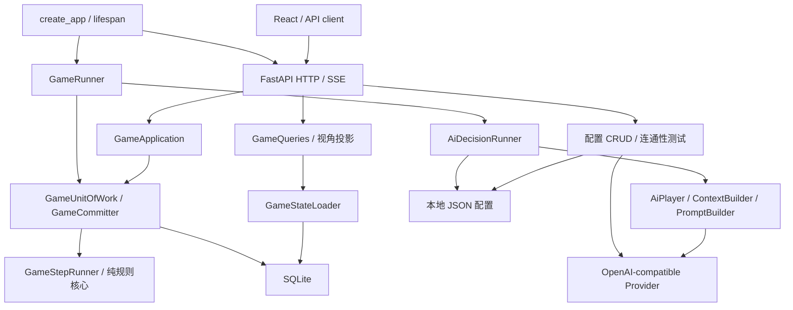
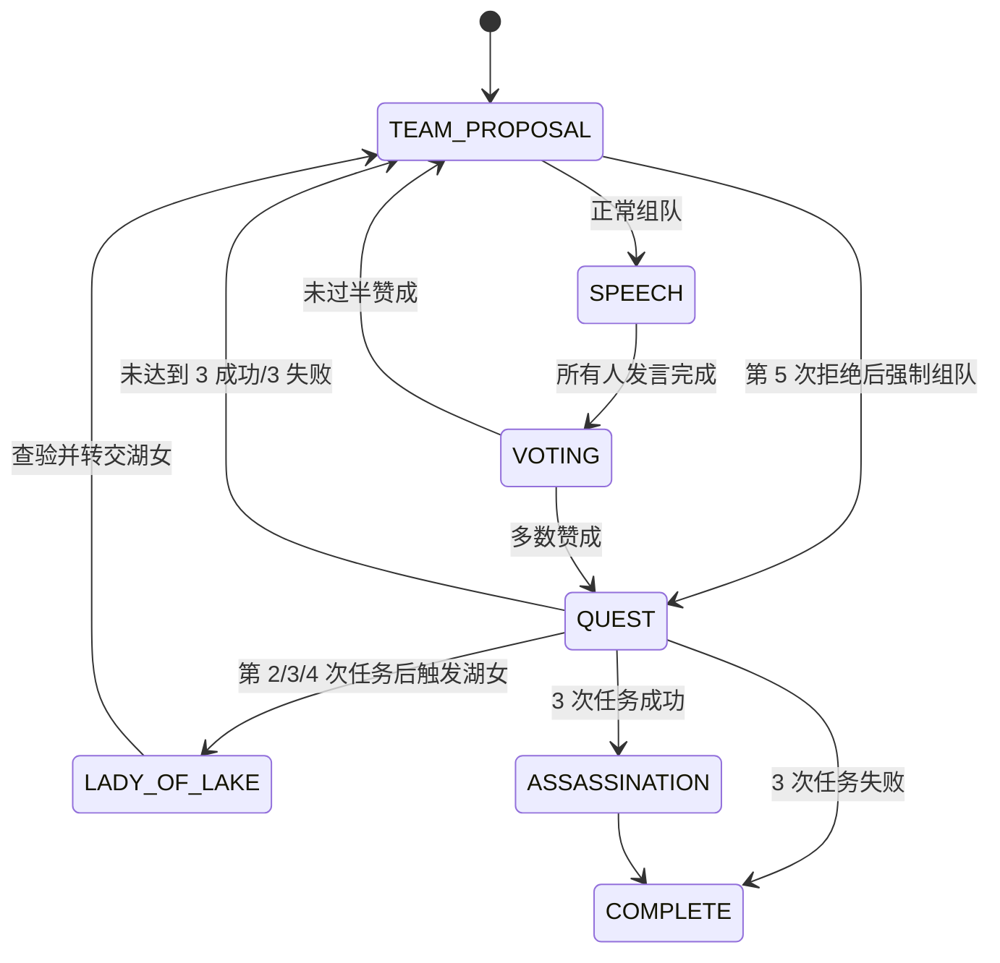

# SoloAvalon 模块与逻辑架构

核对日期：2026-10-18。本文记录当前实现，后端模块与执行细节见[后端模块与运行机制](./backend-modules.md)，设计与迁移记录见[后端重设计方案](./game-service-redesign.md)，用语见[领域术语](../CONTEXT.md)。最初规格保存在 `docs/superpowers/`，不作为当前接口说明。

## 1. 项目定位与边界

SoloAvalon 是本地单用户、可同时保留多个房间的阿瓦隆 Web 应用。每局 1 名真人、其余 AI；确定性 Python 规则裁判动作与胜负，SQLite 保存规则事实和审计，JSON 文件保存模型配置，React 负责游玩、模型管理与完成态复盘。

后端是唯一规则裁判。AI 与真人动作不享有不同规则，前端也不自行计算隐藏身份或绕过后端。AI prompt 使用玩家合法私有视角及白名单公开事件。没有离线 fallback，AI 最终失败后暂停并保留重试意图。

## 2. 运行架构与代码入口



| 路径 | 责任 |
| --- | --- |
| `backend/app/main.py` | `create_app()` 装配每应用独立组件，lifespan 启停推进器和关闭资源。 |
| `backend/app/api/` | 请求规范化、响应模型、HTTP 错误映射和公开 SSE。 |
| `backend/app/services/` | 命令、查询、后台任务、单步规则、工作单元、审计、重放与公开投影。 |
| `backend/app/game/` | 不依赖 HTTP、数据库或外部模型的领域模型与规则。 |
| `backend/app/ai/`、`prompting/`、`llm/` | 合法上下文、消息、输出解析和单次模型调用。 |
| `backend/app/storage/` | SQLite 连接与仓储、文件型模型配置仓储。 |
| `frontend/src/` | 交互、API、SSE、等待策略、复盘与样式。 |
| `config.example/` | 示例配置；真实配置在被 git 忽略的 `config/`。 |
| `tests/` | 按层组织的单元与 HTTP／生命周期集成检查。 |

`GameService` 只保留组件装配，不保存 `_states` 缓存。查询和工作单元为文件数据库各自打开短连接；模型调用期间没有数据库连接或全局业务锁。默认最多 4 局并行推进，同局最多一个任务。生产使用单进程；不提供跨进程租约或队列。

## 3. 规则核心：`backend/app/game/`

规则层是确定性领域核心，主要文件：

- `models.py`：定义 `Role`、`Faction`、`Phase`、`Vote`、`MissionAction`、`GameOption`、`Player`、`MissionConfig`、`LadyOfLakeInspection`、`GameState`、`PrivateView`。
- `rules.py`：实现身份阵营映射、建局、私有视角、组队、发言、投票、任务、湖女、刺杀和胜负结算。
- `events.py`：构建开局、身份分配、私有视角记录的公开/私有事件 payload。

运行中的动作事件主要由 `GameStepRunner` 构造，`game/events.py` 不是所有事件的统一定义中心。

当前规则常量包含：

- 5-10 人任务配置 `STANDARD_MISSION_CONFIGS`。
- 5-10 人阵营人数配置 `STANDARD_FACTION_COUNTS`。
- 5-10 人基础身份配置 `STANDARD_ROLE_SETUPS`：
  - 5 人：梅林、派西维尔、忠臣；莫甘娜、刺客。
  - 6 人：梅林、派西维尔、2 名忠臣；莫甘娜、刺客。
  - 7 人：梅林、派西维尔、2 名忠臣；莫甘娜、刺客、奥伯伦。
  - 8 人：梅林、派西维尔、3 名忠臣；莫甘娜、刺客、爪牙。
  - 9 人：梅林、派西维尔、4 名忠臣；莫甘娜、刺客、莫德雷德。
  - 10 人：梅林、派西维尔、4 名忠臣；莫甘娜、刺客、莫德雷德、奥伯伦。
- `create_game()` 支持 5-10 人标准局，`create_five_player_game()` 是兼容封装。
- 9-10 人可开启 Tristan / Isolde，规则层会用这对身份替换两个忠臣。
- 8-10 人可开启湖中仙女，湖女作为完整规则阶段处理。

阶段流转：



关键规则约束：

- 只有当前队长能提车队。
- 车队人数必须匹配当前任务配置。
- 发言按队长开始的固定座位顺序进行。
- 投票必须全员完成后才能结算，多数赞成才通过。
- 第五次连续组队失败后触发强制车队，绕过发言和投票直接进入任务。
- 只有任务队员能提交任务行动。
- 善方不能提交失败任务。
- 任务失败牌数量达到当前任务阈值时任务失败。
- 3 次任务失败恶方胜利；3 次任务成功进入刺杀。
- 只有刺客能刺杀，刺中梅林则恶方胜利，否则善方胜利。
- 启用湖中仙女时，第 2、3、4 次任务结算且未进入刺杀/结束时进入 `LADY_OF_LAKE`；持有者只能查看一名从未持有过湖女的玩家阵营，结果只进入持有者私有视角，随后湖女转交给目标。

私有视角由 `private_view_for_player()` 统一生成：

- 玩家总能看到自己的精确身份。
- 梅林看到除 Mordred 外的恶方，但只标记为 `unknown_evil`。
- Percival 看到 Merlin 和 Morgana 候选，但只标记为 `unknown_merlin`。
- 非 Oberon 恶方能看到其他非 Oberon 恶方，但不暴露精确角色。
- Tristan 和 Isolde 能互相识别。
- 湖女持有者能看到自己通过湖女查验得到的目标阵营。
- 普通忠臣看不到隐藏身份。

## 4. 命令、版本与后台推进

### 4.1 建局和真人动作

建局在一个事务中保存 `games`、`players` 和全部开局事件。手动动作在短事务中从持久化历史重建最新状态，校验版本与当前动作，执行规则并提交事件、摘要和下一推进意图。提交后才通知 SSE 和推进器。

两个动作接口必须提供 `expected_revision`：

```json
{
  "expected_revision": 12,
  "action_type": "vote",
  "vote": "approve"
}
```

`POST /api/games/{game_id}/ai-actions/human` 的请求体只需 `expected_revision`。过期返回 409 和当前版本，不自动执行旧请求；非法动作返回 400。动作响应仅等待本次事务完成，不等待后续模型链路。

### 4.2 持久化推进意图

`games.revision` 是执行相关修改版本，旧局迁移从 0 开始，与审计行数无关。`advance_mode=null` 表示无需后台推进，`auto` 表示普通 AI 或系统结算，`human_once` 表示已请求一次真人代打。

只有未归档、`status=active` 且模式非空的对局可执行。错误暂停保留模式；归档或结束清空模式。真人代打成功后根据新状态切换到 `auto` 或 `null`，不自动接管下一个真人动作。

`GameRunner` 先短读取状态与版本，再在事务外调用 `AiDecisionRunner`；写入前重读并比对版本、阶段、行动者、状态和模式。旧成功与旧错误都丢弃，不追加审计、不暂停新状态。当前成功原子保存规则、审计、记忆与摘要；当前失败原子保存错误审计与暂停状态。善方固定成功和系统结算走同一单步提交路径，但不调用模型。

默认单个推进任务上限 100 步，超限写诊断并暂停。应用启动扫描未完成意图，运行中使用提交唤醒和定期补扫，补偿提交后尚未通知就退出的窗口。外部模型调用或计费不保证恰好一次，规则动作受版本校验保护。

### 4.3 恢复与状态来源

恢复以建局元数据、真实玩家、`game_created.missions` 和内部规则事件为依据；旧局缺少任务配置时回退标准常量。规则事件按内部序号重放，已知审计跳过，未知类型或坏事件返回位置诊断，不截断日志继续写入。

启动时可为成功恢复的未归档 `active` AI／系统回合补设 `auto`，不会擅自接管真人，也不会自动重试暂停局。`/retry` 显式恢复暂停局，保留 `human_once`，或为活跃 AI 回合补意图。GET 状态、事件和房间始终是查询。

轮次、阶段、胜者属于可校验重建的规则摘要；暂停、归档、模型 ID 和推进意图不是缓存，重建不会覆盖它们。当前不增加状态缓存或规则快照。

## 5. AI、Prompt 与模型配置

`AiDecisionRunner` 统一普通 AI 和真人代打，玩家覆盖 ID 优先于对局默认 ID。文件配置仓储不访问 SQLite；不存在的覆盖不会悄悄改用另一个模型。

`ContextBuilder` 生成稳定规则前缀、合法私有视角、公开状态与历史、合法动作、上下文摘要。`PromptBuilder` 输出系统前缀及玩家视角、动作格式、活动日志、本次行动四条 user 消息。原始动态私有 JSON 不直接发送给模型。

`AiPlayer` 调用 Provider 并解析决策，成功返回 `AiTurnResult`，最终失败抛出带审计信息的 `AiDecisionError`。决策仍通过 `GameStepRunner` 调用纯规则。记忆快照只留档，不参与后续上下文；稳定前缀哈希和缓存用量不是独立缓存服务。

模型配置使用 Pydantic 校验，由 OpenAI Python SDK 发出 Chat Completions 请求，结果统一为 `LlmCompletionResult`（`.content` 与可选用量）。连通性测试读取同一结果契约。HTTP 客户端在完成或失败后关闭，测试注入假 transport。

`transport_retries` 只重试明确超时和空回答，`parse_retries` 处理解析或决策格式错误，默认各 5 次额外尝试。SDK 自带网络／状态码重试关闭。旧 `timeout_retries` 分别填补缺失的新字段；保存时只写新字段。推理参数使用 `reasoning_effort`，旧 `temperature` 被忽略。

配置路径：模型使用 `SOLOAVALON_LLM_CONFIG` 或 `config/llm_profiles.json`；Prompt 使用 `SOLOAVALON_PROMPT_CONFIG` 或 `config.example/prompt_templates.json`，每个正文文本项由 JSON 单独引用一个 Markdown 文件，路径相对于该配置文件，默认位于 `config.example/prompts/`。JSON 保留引用顺序、结构化配置与输出契约。模型配置文件修改进程内串行，用临时文件替换保存。SQLite 不保存 API Key，公开配置仅提供脱敏值，编辑时留空保留旧 key。

## 6. 数据存储与事务

| 表 | 保存内容 |
| --- | --- |
| `games` | 初始元数据、人数和可选项、派生摘要、运行状态、归档、模型 ID、版本与推进意图。 |
| `players` | 座位、匿名和原始名称、真人标记、真实身份与阵营、模型覆盖。 |
| `game_events` | 内部连续序号、规则和审计、公开与私有 payload。 |
| `ai_decisions` | 输出、私有理由、版本、校验状态与用量；完整 Prompt 在对应私有审计事件。 |
| `ai_memory_snapshots` | 记忆观察留档，不参与规则重放。 |

`GameUnitOfWork` 使用 `autocommit=False` 仓储，把创建、动作、暂停与管理操作纳入完整短事务，统一回滚。`GameCommitter` 保留已有单步持久化逻辑，但生产提交由外层工作单元负责。提交前不更新缓存或通知。

`Database` 为文件数据库使用 WAL 和独立短连接，结束后关闭；`:memory:` 使用测试作用域连接，数据库范围内串行使用。不会让模型配置写文件操作提交其他对局的 SQLite 事务。

## 7. 公开事件、审计和 SSE

列表、状态和事件使用显式白名单，列表不暴露有序 `role_set`。状态从真人的 `PrivateView` 生成，只有规则完成后才公开完整身份。普通事件不输出 AI 决策、Prompt、私有理由、调用类型或私有任务行动。

公开事件的 `id` 与 `event_index` 独立连续编号，不沿用内部序号。查询先投影完整历史，再按公开 `after` 截取；SSE 使用相同映射。投影不改写已有数据库日志。

| 事件 | 普通游玩内容 |
| --- | --- |
| `game_created`、`roles_assigned` | 人数、公开任务配置和开局事实，不带身份映射。 |
| `team_proposed`、`speech` | 队长与车队、玩家发言。 |
| `vote_cast` | 只表示玩家已投票，不输出票值。 |
| `vote_result` | 是否通过、拒绝次数及完整 `votes`；旧日志从此前投票聚合。 |
| `quest_action_submitted` | 只表示已提交，不带单人成功／失败。 |
| `quest_result` | 累计结果、成功牌和失败牌数、阶段与胜者。 |
| `lady_of_lake_used` | 查看者、目标和转交事实，不带阵营结果。 |
| `assassination` | 刺客、目标和胜者。 |
| `private_view_recorded`、`ai_decision`、`runner_error` | 不进入普通事件流，仅保留在内部历史。 |

SSE 建连先输出 `game-state`，再按公开游标补发 `game-event`，随后等待提交通知或输出心跳。只有 `game-event` 有公开事件 ID；`game-state` 携带最新状态、`revision` 和 `is_advancing`，不改变游标，因此无公开规则事件的暂停或恢复也会通知前端。

`/room`、私有事件查询和私有导出在完成前返回 409，归档不绕过此检查。完成态完整复盘使用内部事件集合；普通状态、公开事件与公开导出仍保持公开过滤。

## 8. 前端模块与异步交互

| 文件 | 职责 |
| --- | --- |
| `App.tsx` | 开局、游玩、模型与归档房间界面，动作、代打和重试。 |
| `api.ts` | HTTP 类型与请求、必需动作版本、错误处理和旧状态忽略。 |
| `gameSession.ts` | `game-event` / `game-state` 分流，以及等待后台完成或暂停。 |
| `flowReview.ts` | 公开或完整事件转轮次、广播、发言、票型和任务复盘，不裁判规则。 |
| `apiKey.ts`、`styles.css` | 输入密钥展示脱敏与既有界面样式。 |

前端按版本接收状态，使用 `is_advancing` 控制等待和重复代打。不能把“请求已接受”当成“真人动作已由 AI 完成”。409 后刷新状态，不重放旧动作。`vote_result.votes` 足以还原刚结算票型，不依赖重写已收到的 `vote_cast`。

公开 `activeGameEvents` 与完成态 `RoomDetail.events` 分开使用，不按混合序号合并。未完成的归档房间加载公开状态和事件，只有完成后才请求完整审计及私有导出。

Vite 默认端口 `5173`，`/api` 代理默认 `127.0.0.1:8000`；`SOLOAVALON_BACKEND_URL` 和 `SOLOAVALON_FRONTEND_ORIGIN` 支持一键启动的动态端口。

## 9. 验证和维护

规则检查在 `tests/game/`；工作单元、重放、并发旧回答、重启与 lifespan 在 `tests/services/`；HTTP、公开字段、导出与 ASGI SSE 在 `tests/api/`；配置和真实 Provider 加假 transport 在 `tests/llm/`。无需真实密钥或模型。

前端 `gameSession.test.ts` 执行等待、版本与 SSE 逻辑，`flowReview.test.ts` 执行投票和复盘转换；`App.test.ts` 的源码／样式断言只是补充，不是完整组件交互测试。验证不点击用户屏幕。

```powershell
.venv\Scripts\python.exe -m unittest discover -s tests -v
cd frontend
npm run test
npm run build
```

修改事件 payload 时同步检查规则重放、公开白名单、AI 活动日志、SSE、复盘和导出。修改规则优先补规则层验证；修改模型配置时保留旧文件读取兼容，真实密钥不写入示例或快照。

当前没有跨进程租约、外部队列、任意身份池编辑、决策记忆循环或状态快照。保留单机单进程边界，不为未出现的读取成本扩展缓存或更换技术栈。
