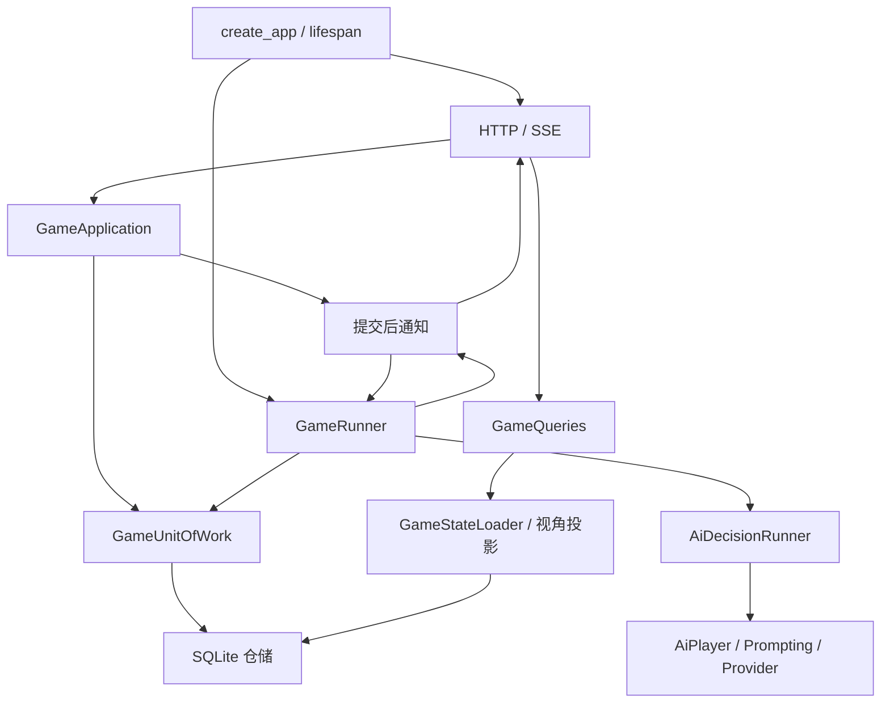

# 后端模块与运行机制

核对日期：2026-10-18。本文记录当前实现。整体架构见[架构总览](./architecture.md)，实施契约与分阶段记录见[后端重设计方案](./game-service-redesign.md)，领域用语见[领域术语](../CONTEXT.md)。

## 总体分层

后端保留 FastAPI、SQLite、文件型模型配置和确定性规则核心。命令、查询与后台推进分开，模型调用不占用 SQLite 事务或全局业务锁。



## 模块职责

### 应用装配与生命周期

`backend/app/main.py` 提供 `create_app()`。每个应用有自己的 `app.state.services`；`GameService` 只装配应用、查询、决策与推进组件，不再保存规则缓存或转发旧同步接口。模块级 `app` 是供 Uvicorn 使用的默认工厂产物，不再暴露全局数据库连接或 `game_service`。

应用 lifespan 启动推进器，校验历史并扫描持久化推进意图；退出时停止接收新任务并关闭数据库资源。尚在网络调用中的工作不会因退出而提交旧回答，未完成意图供下次启动恢复。

数据库路径取自 `SOLOAVALON_DB`，默认仓库根目录 `soloavalon.sqlite3`。前端 CORS 默认允许 `localhost:5173` 与 `127.0.0.1:5173`，可通过 `SOLOAVALON_FRONTEND_ORIGIN` 添加来源。

### API 与响应边界

| 文件 | 职责 |
| --- | --- |
| `api/models.py` | 解析建局、真人动作和模型配置请求；定义 `GameView`、`GameSummaryView`、`PublicEventView` 与完成态 `RoomReview`。 |
| `api/games.py` | 适配命令和查询，输出公开事件、状态 SSE、房间复盘及导出。动作端点只等待本次提交，不等待后续 AI。 |
| `api/llm_profiles.py` | 配置 CRUD、空密钥保留、脱敏与连通性测试；测试读取 Provider 结果的 `.content`。 |
| `api/errors.py` | 整理参数或服务异常；版本过期和未完成审计访问单独返回 409。 |

`/actions` 与 `/ai-actions/human` 必须带非负整数 `expected_revision`。过期返回 409 和 `detail.current_revision`，不重试执行旧命令；其他非法动作返回 400。AI 后台失败通过状态查询或 `game-state` 的 `error_paused` 表达。

### 应用层

| 文件与组件 | 职责 |
| --- | --- |
| `services/game_application.py` / `GameApplication` | 建局、手动动作、代打意图、显式恢复、归档与删除；提交后通知 SSE 并唤醒推进器。 |
| `services/game_queries.py` / `GameQueries` | 列表白名单、真人视角、公开事件、完成态完整审计、导出与用量统计；从不安排推进。 |
| `services/game_runner.py` / `GameRunner` | 有界线程池、同局唯一任务、启动恢复、通知唤醒和定期补扫；一次只应用一个规则步骤。 |
| `services/ai_decision_runner.py` / `AiDecisionRunner` | 从玩家覆盖或对局默认 ID 解析文件配置，统一普通 AI 和真人代打的决策、成功审计与失败审计。 |
| `services/game_work.py` / `GameUnitOfWork` | 管理单次操作的连接、事务、最新状态读取和版本检查。 |
| `services/game_flow.py` / `GameStepRunner` | 执行玩家动作或系统结算，返回 `StepResult`，不访问外部模型或提交数据库。 |
| `services/game_flow.py` / `GameCommitter` | 保存单步规则事件、AI 审计、记忆和规则摘要；生产路径的提交与回滚归外层工作单元。 |
| `services/game_flow.py` / `GameStateLoader` | 依据玩家真相、已保存任务配置和内部历史重放；已知审计跳过，未知事件或坏规则事件保留失败位置诊断。 |
| `services/event_visibility.py` | 允许事件与字段白名单、独立公开序号、旧投票结算聚合、发言玩家名规范化。 |
| `services/event_notifier.py` | 提交后跨线程唤醒 SSE 订阅；通知本身不是持久化任务或事件。 |

旧 `GameAdvanceLoop` 和 `GameService` 中的重复阶段分支已移除。当前不维护状态缓存，命令和查询都从各自的数据库范围读取。

### 规则、AI 与模型

`game/models.py` 定义领域状态和玩家视角；`game/rules.py` 是唯一规则裁判；`game/events.py` 构造开局事件。支持 5-10 人标准局、8-10 人湖女和 9-10 人 Tristan / Isolde。动作来源不提供规则豁免，善方任务固定成功也经过同一规则执行和提交路径。

`ai/context.py` 使用合法私有视角及过滤后的公开历史构建上下文；`prompting/templates.py` 输出稳定规则前缀、玩家视角、动作格式、活动日志、本次行动五段消息。配置由 `SOLOAVALON_PROMPT_CONFIG` 或 `config.example/prompt_templates.json` 读取。`ai/player.py` 解析回答并返回 `AiTurnResult`，最终失败抛出带审计上下文的 `AiDecisionError`；没有确定性 fallback。

`llm/provider.py` 使用 OpenAI Python SDK，支持自定义 API 前缀和兼容完整 `/chat/completions` 地址。结果统一为 `LlmCompletionResult`，包含文本及可选 Token、缓存用量。SDK 自带重试关闭，项目只对明确捕获的超时和空回答执行 `transport_retries`；输出解析或决策校验失败由 `AiPlayer` 的 `parse_retries` 控制，不对任意网络或 HTTP 错误重试。

两项重试默认均为 5，均指首次尝试以外的额外次数。旧 `timeout_retries` 分别补足缺失的新字段；再次保存只写新字段。旧 `temperature` 被忽略，缺少 `reasoning_effort` 时使用 `medium`。

### 存储

| 表或文件 | 内容 |
| --- | --- |
| `games` | 初始元数据、规则派生摘要、运行状态、归档、模型 ID、`revision` 和 `advance_mode`。 |
| `players` | 座位、名称、真人标记、真实身份与阵营、玩家模型覆盖。 |
| `game_events` | 内部连续序号的规则事实与审计，保留恢复所需的私有 payload。 |
| `ai_decisions` | 决策输出、理由、版本、校验状态与用量；完整 Prompt 在对应审计事件的私有 payload。 |
| `ai_memory_snapshots` | 只作私有留档，当前不读入后续 AI 决策。 |
| `config/llm_profiles.json` | 本地模型配置和 API Key；支持 `SOLOAVALON_LLM_CONFIG`。SQLite 不保存真实密钥。 |

`Database` 对文件数据库使用独立短连接、外键和 WAL；每次工作单元关闭连接。`:memory:` 使用单个测试作用域连接，只在数据库范围内串行使用，不跨模型调用持锁。文件配置仓储只做 JSON 读写，进程内串行修改并用临时文件替换，不查询 SQLite 或提交对局事务。

## 关键数据流

### 创建与手动动作

```text
开始短写事务
  -> 创建完整 games / players / 开局事件，或重放当前状态并检查 expected_revision
  -> GameStepRunner 应用合法动作
  -> 保存事件、规则摘要和运行状态
  -> 更新 advance_mode，递增 revision
提交并关闭连接
  -> 通知 SSE，唤醒 GameRunner
  -> 返回真人视角状态
```

建局的任意写入失败均整局回滚。手动合法动作可以覆盖本阶段未完成的真人代打；旧回答因版本不同而丢弃。

### 后台 AI 单步

```text
短读取：状态、revision、阶段、行动者、advance_mode
关闭连接
  -> 选择模型并调用 AiPlayer，或执行无需模型的系统步骤
短写事务
  -> 重读并检查版本、运行状态、推进模式、阶段和行动者
  -> 旧成功或旧错误：不追加审计、不修改当前规则、不暂停新状态
  -> 当前成功：规则事件、AI 审计、记忆、摘要和下一推进模式一同提交
  -> 当前失败：错误审计和 error_paused 一同提交，保留推进意图
提交后通知，再判断是否继续
```

同局同时最多一个推进任务；默认最多 4 个房间同时运行，单个推进任务最多执行 100 步。达到步数上限写入诊断并暂停，不留下没有任务的正常 `active` 对局。网络调用或计费不承诺恰好一次；版本检查保证旧动作不重复落库。

## 状态与事务边界

`revision` 从旧数据库的 0 开始。有效规则动作、代打安排、暂停、恢复、归档等执行相关操作递增版本，公开版本不取内部审计数量。

| advance_mode | 含义 |
| --- | --- |
| `null` | 不需要后台推进；通常等真人操作、已经完成或已归档。 |
| `auto` | 推进普通 AI 或系统结算，遇到真人时停止。 |
| `human_once` | 已请求一次真人代打；成功后改为 `auto` 或 `null`，不继续接管下一次真人动作。 |

可执行条件是未归档、`status=active` 且推进模式非空。错误暂停保留失败前模式；归档和规则完成清空模式。

启动恢复先重放规则历史并校验摘要，再安排任务。已保存的 `game_created.missions` 优先于当前常量；缺少该字段的旧局明确回退标准配置。任务行动和湖女恢复仍依赖私有 payload，不能删除这些事实。未知事件和损坏历史保持停止、保留诊断，不截断后继续追加。

旧 `active` AI／系统回合可补设 `auto`；真人、暂停、完成和归档局不自动接管。显式 `/retry` 可以恢复暂停局或补上活跃 AI 回合的意图。历史里未记录的真人代打不猜测。摘要重建只修复轮次、阶段、胜者，不覆盖暂停、归档、配置或推进意图。

## 公开信息与完成态审计

普通列表不序列化 `role_set` 或完整仓储对象。状态只从真人的合法 `PrivateView` 投影；完成后才公开所有身份。`private_view_recorded`、`ai_decision`、`runner_error` 不进入公开事件流；允许事件也按字段白名单投影，过滤历史日志中的私有理由。

公开 `id` 和 `event_index` 从 1 独立连续编号，既不沿用内部审计序号，也不暴露内部记录数量。查询先投影完整历史，再按公开 `after` 筛选；不能把公开游标传给按内部序号读取的仓储方法。

`vote_cast` 始终只表示玩家已投票。`vote_result.votes` 携带完整票型，旧记录从前面的 `vote_cast` 聚合补足；客户端不需要修改已收到的旧事件。

`/room`、`include_private=true` 事件和私有导出只有规则完成后才提供。进行中或未完成的归档局返回 409；普通状态、公开事件和公开导出仍可读取。完整复盘与公开事件使用独立集合，前端不混合二者的序号。

## SSE 与前端协作

SSE 建连先发 `game-state`，然后按公开游标补发 `game-event`，之后等待提交通知；无更新时输出心跳。`game-event` 的 SSE ID 是公开序号；`game-state` 没有事件 ID，不推进游标，用于表示代打安排、暂停、恢复和归档等无公开规则事件的修改。

前端按 `revision` 忽略旧状态，以 `is_advancing` 判断任务是否结束。连续代打等待本次后台工作结束或暂停后才发下一请求。未完成归档房间仅加载公开状态和事件；完成态才加载完整复盘。

## 验证与阅读顺序

建议按规则 → `GameStepRunner` / `GameUnitOfWork` → `GameApplication` / `GameRunner` → `GameQueries` → AI 与仓储阅读。

`tests/services/test_game_service.py` 验证完整建局回滚、版本竞争、六类 AI 决策失败、慢调用期间其他房间命令、旧成功与旧失败丢弃、数据库重开、任务配置和完整对局。`test_game_flow_modules.py` 保留单步事务与重放检查；`test_game_lifecycle.py` 验证 lifespan、定期补扫、有界执行器和停机意图保留。

`tests/api/test_games_api.py` 通过真实 HTTP 路由与 ASGI SSE 验证公开边界、409、导出和游标。模型 HTTP 适配使用真实 Provider 加假 HTTPX transport，不访问真实密钥或真实模型。前端 `gameSession.test.ts` 执行等待、SSE 分流和版本请求逻辑，`flowReview.test.ts` 验证公开增量投票复盘；原 `App.test.ts` 的源码与样式检查只是补充。

```powershell
.venv\Scripts\python.exe -m unittest discover -s tests -v
cd frontend
npm run test
npm run build
```

## 当前范围

仅支持本地单进程，不使用跨进程租约、外部队列或多进程工作器。进程中断后外部模型请求可能重发，但已提交规则步不重复应用。当前不增加规则快照、状态缓存或记忆智能体；只在真实读取成本或产品需求出现后再设计。
