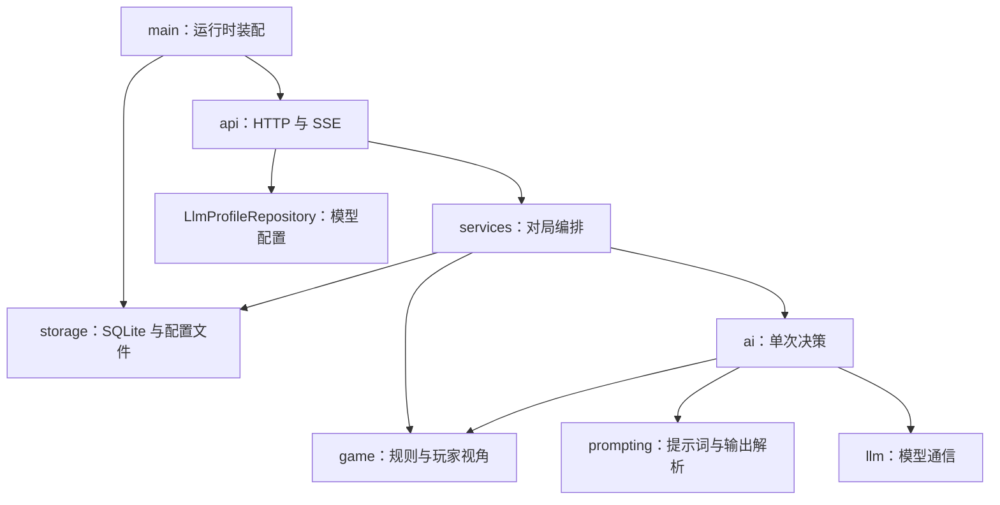

# 后端模块与运行机制

核对日期：2026-10-17。本文记录当前代码，不代表目标架构已经实现。整体架构见[架构总览](./architecture.md)，目标职责、接口和迁移步骤见[后端重设计方案](./game-service-redesign.md)，领域用语见[领域术语](../CONTEXT.md)。

## 总体分层

当前后端是 FastAPI 加标准库 SQLite 的分层单体。规则层决定动作是否合法及其结果，服务层安排执行顺序，AI 链路生成行动建议。



对局请求经过 `GameService`；模型配置 CRUD 和连通性测试由 API 直接调用配置仓储和 Provider。不是所有接口都经过服务层。

## 模块职责

### 1. main：应用装配

`backend/app/main.py` 在模块导入时完成以下动作：

- 从 `SOLOAVALON_DB` 读取数据库路径，默认使用仓库根目录 `soloavalon.sqlite3`。
- 创建共享 SQLite 连接，初始化 schema 和兼容迁移。
- 创建全局 `GameService`、`LlmProfileRepository` 和 FastAPI 应用。
- 配置本地前端 CORS，支持 `SOLOAVALON_FRONTEND_ORIGIN`。
- 挂载对局和模型配置路由。

该模块不裁判规则，目前也没有通过应用生命周期统一管理连接和推进任务。

### 2. api：请求、响应与事件流

| 文件 | 当前功能 |
| --- | --- |
| `backend/app/api/models.py` | 使用 dataclass 和 `from_payload()` 手动解析建局、真人动作和模型配置请求。建局会校验人数与可选机制组合；动作的阶段和规则约束留给服务与规则层。 |
| `backend/app/api/games.py` | `GamesApi` 适配对局服务；路由提供建局、查询、动作、AI 代打、重试、房间详情、归档、删除、事件和导出。负责后台建局推进与 SSE 帧输出。 |
| `backend/app/api/llm_profiles.py` | 配置 CRUD、空密钥保留旧值、公开密钥脱敏和连通性测试。直接访问配置仓储与 Provider。 |
| `backend/app/api/errors.py` | 将异常整理为 `message`、`error_type` 和 `traceback`。路由将参数错误映射为 400，AI 超时映射为 504，其他 AI 决策错误映射为 502，未预期异常映射为 500。 |

当前请求体主要使用 `dict[str, Any]`，响应主要使用字典；尚未建立与仓储对象分离的完整公开响应模型。

### 3. services：对局编排

`backend/app/services/game_service.py` 中的 `GameService` 是对局业务入口，负责：

- 建局、应用模型覆盖并记录开局事件。
- 校验真人当前可执行动作，支持真人 AI 代打。
- 组合规则执行、AI 决策、事务提交与自动推进。
- 管理 `_states` 内存缓存，缓存缺失时重放恢复。
- 组装真人可见状态、`next_human_action`、房间详情和用量统计。
- 处理 AI 失败审计、错误暂停、重试、归档和删除。

`backend/app/services/game_flow.py` 已拆出以下组件：

| 组件 | 输入与输出 | 职责边界 |
| --- | --- | --- |
| `GameStepRunner` | 玩家动作或系统结算 → `StepResult` | 调用规则函数，构造新状态与规则事件，不写数据库。 |
| `PendingEvent`、`StepResult` | 待提交事件、新状态、可选 AI 决策和记忆 | 是一次执行结果的数据载体，不是已持久化事实。 |
| `GameCommitter` | `StepResult` → 已提交状态 | 在一个事务中保存规则事件、审计事件、AI 决策、记忆和对局摘要；提交后更新缓存并通知 SSE。失败审计与 `error_paused` 也统一提交。 |
| `GameAdvanceLoop` | 当前状态 → 下一个阻塞点的状态 | 按阶段选择 AI 或执行系统结算，最多循环 100 次；遇到真人、结束或错误停止。 |
| `GameStateLoader` | 对局 ID → `LoadedGameState` | 读取建局元数据、玩家真相和事件，重建规则状态并返回重放诊断。 |
| `apply_replay_event()` | 历史事件与旧状态 → 新状态 | 重放已知规则事件，跳过审计事件；当前对其他未知类型直接保留旧状态。 |
| `GameReplayError` | 重放错误及事件位置 | 阻止已知坏尾部被静默忽略后继续写入。 |

其他服务组件：

| 文件 | 当前功能 |
| --- | --- |
| `backend/app/services/event_visibility.py` | 删除私有 payload，隐藏未结算投票票值，并将公开发言中的 `player_N` 转成 `玩家N`。这不是对所有公开字段的白名单过滤，见下文已知缺口。 |
| `backend/app/services/event_notifier.py` | 按对局管理进程内订阅，提交后跨线程唤醒 SSE。只通知有更新，不保存、传输或裁判事件内容。 |

写入口使用同一个 `RLock`，锁覆盖 AI 网络调用，因此不同房间的写操作也会串行等待。查询没有使用同一把锁；所有仓储仍共享同一个 SQLite 连接。

### 4. game：领域模型与规则

| 文件 | 当前功能 |
| --- | --- |
| `backend/app/game/models.py` | 定义身份、阵营、阶段、投票、任务行动、可选机制，以及 `Player`、`GameState`、`PrivateView`、任务和湖女查验数据。 |
| `backend/app/game/rules.py` | 支持 5-10 人建局、身份与座位分配、合法私有视角、组队、顺序发言、投票、任务、湖女、刺杀和胜负。规则函数校验动作并返回新状态，不依赖 HTTP、数据库或模型服务。 |
| `backend/app/game/events.py` | 仅构造 `game_created`、`roles_assigned`、`private_view_recorded` 的公开与私有 payload；运行中规则事件主要由 `GameStepRunner` 构造。 |

`private_view_for_player()` 是身份可知信息的集中入口。最终动作裁判在规则层，不由 Prompt 文案或模型回答决定。

### 5. ai：上下文和单次决策

| 文件 | 当前功能 |
| --- | --- |
| `backend/app/ai/context.py` | `ContextBuilder` 生成 `AiContext`：稳定规则前缀及哈希、玩家合法私有视角、公开状态与历史、合法动作及上下文摘要。默认不截断事件，可配置最近事件数量。 |
| `backend/app/ai/player.py` | `AiPlayer` 执行一次组队、发言、投票、任务、刺杀或湖女决策。调用失败或最终解析失败时抛出带审计上下文的 `AiDecisionError`，成功返回 `AiTurnResult`。 |
| `backend/app/ai/strategy.py` | 定义各类决策 dataclass，承载动作、公开表达和私有理由；不是独立策略引擎，也没有确定性 fallback。 |

AI 不自行推进整局或落库。善方任务行动由服务层直接提交 `success`，不调用模型。当前记忆快照没有被读入后续 AI 上下文。

### 6. prompting：提示词和输出契约

| 文件 | 当前功能 |
| --- | --- |
| `backend/app/prompting/config.py` | 加载并校验 Prompt 版本、身份说明、策略提示、可选机制文案和动作输出要求。默认读 `config.example/prompt_templates.json`，支持 `SOLOAVALON_PROMPT_CONFIG`。 |
| `backend/app/prompting/templates.py` | `PromptBuilder` 渲染五段消息：稳定系统前缀、玩家视角、动作格式、活动日志、本次行动。不会直接发送 `dynamic_private_suffix` 的原始 JSON。 |
| `backend/app/prompting/schemas.py` | 解析 JSON 或允许的发言、投票文本，检查队伍、行动值和目标范围，产出决策对象。实际执行仍要经过规则层。 |

Prompt 配置描述规则和玩法，但不决定真实身份池、阶段和胜负。稳定前缀及缓存用量记录也不等于后端实现了模型缓存服务。

### 7. llm：配置类型和模型通信

| 文件 | 当前功能 |
| --- | --- |
| `backend/app/llm/profiles.py` | 使用 Pydantic 定义 `LlmProfileInput`、`LlmProfile` 和文件结构 `LlmProfileConfig`，统一校验 API 输入与文件配置，并生成脱敏公开字段。 |
| `backend/app/llm/provider.py` | 通过 OpenAI Python SDK 调用自定义 `/chat/completions` 服务，返回 `LlmCompletionResult`，包含文本、Token 用量和缓存命中数据。SDK 负责网络重试和类型化异常；HTTP 客户端在调用结束或失败后关闭，测试注入 HTTPX transport。 |

保留 `timeout_retries` 字段和默认值 5：它映射到 SDK 的 `max_retries`，处理连接错误、超时、HTTP 408、409、429 和 5xx；同一个参数还被 `AiPlayer` 用于空回答、输出解析和决策校验失败重试。网络失败不会再在 AI 层重试，避免叠加两套网络重试循环。

### 8. storage：持久化

| 文件 | 当前功能 |
| --- | --- |
| `backend/app/storage/database.py` | 创建 SQLite 连接、启用外键、初始化 schema、补列，并迁移旧模型配置表引用。 |
| `backend/app/storage/schema.py` | 定义 `games`、`players`、`game_events`、`ai_decisions`、`ai_memory_snapshots` 五张表。 |
| `backend/app/storage/game_repository.py` | 保存对局与真实玩家信息，读取摘要和玩家，生成房间编号，更新状态，归档、删除和设置模型覆盖。 |
| `backend/app/storage/event_store.py` | 按对局序号追加事件，查询全部或增量事件，导出日志。重放不在仓储中执行。 |
| `backend/app/storage/ai_decision_repository.py` | 保存并读取决策结果、理由、原始与解析输出、版本、校验状态和用量。完整 Prompt 消息保存在对应事件的私有 payload 中。 |
| `backend/app/storage/ai_memory_repository.py` | 校验、保存和查询记忆快照；当前业务主要写入决策摘要，没有形成记忆读写循环。 |
| `backend/app/storage/llm_profile_repository.py` | 通过 Pydantic 读取和序列化本地模型配置 JSON，通过临时文件替换保存，不再依赖 SQLite。玩家覆盖优先、对局默认其次的模型选择由 `GameService` 负责。 |

真实模型配置默认位于 `config/llm_profiles.json`，支持 `SOLOAVALON_LLM_CONFIG`；SQLite 不保存 API Key。

## 关键数据流

### 创建对局

```text
POST /api/games
  -> 解析建局请求
  -> GameService.create_game(auto_advance=False)
  -> 规则建局，保存 games / players / 开局事件
  -> 返回初始真人视角状态
  -> BackgroundTasks 调用 advance_game
  -> GameAdvanceLoop 推进，提交后通知 SSE
```

直接调用 `GameService.create_game()` 默认 `auto_advance=True`，可能等待 AI；不能将这一默认行为套用到 HTTP 创建路由。建局的多次写入目前尚未组成一个外层事务。

### 真人动作与 AI 推进

```text
真人请求
  -> 读取缓存或恢复状态，校验 next_human_action
  -> GameStepRunner 应用规则，返回 StepResult
  -> GameCommitter 原子提交当前步
  -> GameAdvanceLoop 选择后续行动者
  -> AiPlayer 构建上下文、调用模型、解析回答
  -> GameStepRunner 再次用规则裁判
  -> 附加 AI 审计，由 GameCommitter 提交
  -> 重复，直到真人动作、结束或失败
```

真人 AI 代打和普通 AI 推进目前有重复的阶段分支，但共用 `AiPlayer`、规则执行器和提交器。

### AI 失败与恢复

`AiDecisionError` 被服务层捕获后，由 `commit_ai_error()` 原子保存失败审计与 `error_paused`，不保存当前失败步的规则事件，随后向调用方抛出。重试会先从持久化历史重读状态，再继续自动推进；没有自动 fallback。

### 事件查询与 SSE

普通事件查询使用公开过滤。SSE 接受 `after` 游标，先从数据库补发后续事件，再等待进程内通知；无新事件时发送心跳。通知不是持久化消息队列，应用退出后不会保留后台任务。

### 状态恢复

```text
GameStateLoader
  -> games 中的人数和可选项、players 中的真实玩家
  -> 用当前 STANDARD_MISSION_CONFIGS 重建初始状态
  -> 按 event_index 重放规则事件，跳过已知审计事件
  -> 返回 GameState 或明确的重放失败位置
```

因此不是仅靠公开事件恢复，也不是完整的事件溯源框架。任务行动需要私有 `mission_action`，湖女事件需要私有 `target_faction`；这些内容不能从运行数据库中删除。

## 状态与事务边界

| 数据 | 当前用途 |
| --- | --- |
| `_states` | 进程内运行态缓存，真人动作优先使用它。 |
| `games`、`players` | 建局元数据与真实玩家；`games` 还保存轮次、阶段、胜者、错误暂停和归档信息。 |
| `game_events` | 可重放规则历史与非规则审计，二者混存在同一表。 |
| `ai_decisions`、`ai_memory_snapshots` | 决策与记忆留档，不参与规则恢复。 |

`GameCommitter` 已保证一次推进步的数据库写入共同提交或回滚，并在提交后更新缓存。默认仓储仍支持自动提交，建局及其他管理入口尚未统一成一个工作单元。`status=error_paused` 和归档属于运行管理状态，不能只靠规则事件重建；不要将整个 `games` 表都视为可丢弃的规则投影。

恢复规则状态不会自动恢复执行任务。若进程在 AI 行动中退出，留下 `active` 且没有真人动作的对局，当前查询不推进，重试又只处理 `error_paused`，因而可能停住。

## 已知缺口

以下为 2026-10-17 审查确认的问题，本次文档更新没有修复代码：

| 问题 | 当前代码与影响 |
| --- | --- |
| 对局列表暴露身份顺序 | `GameRepository` 按玩家顺序保存 `role_set`，`GamesApi.list_games()` 整体序列化摘要，普通列表响应可推导每个座位的真实身份。 |
| 私有决策理由进入公开事件 | `AiPlayer` 将 `private_reason_summary` 作为 `strategy_summary`，服务层写入 `ai_decision.public_payload`；删除私有 payload 不能移除它。 |
| 审计访问与游玩边界不完整 | `/room` 和 `include_private=true` 可以读取进行中对局的私有记录，前端完成态控制只是展示条件，不是后端访问边界。 |
| 模型测试返回契约错误 | Provider 返回 `LlmCompletionResult`，模型测试却执行 `content[:160]`；成功回答也会导致 `TypeError`。现有假 Provider 返回字符串，未覆盖该契约。 |
| 中断后的活跃 AI 回合无恢复入口 | 持久化状态可以重放，但后台任务没有恢复，非 `error_paused` 的重试不推进。 |

## 验证与阅读顺序

建议按 `game` → `GameStepRunner` / `GameCommitter` / `GameAdvanceLoop` → `GameService` → AI 链路 → API 与仓储阅读。现有测试按 `tests/game/`、`tests/services/`、`tests/ai/`、`tests/llm/`、`tests/api/`、`tests/storage/` 组织。

后续重构应先覆盖公开响应、真实 Provider 返回类型、建局事务和中断恢复，再调整模块组织。现有 API 测试主要调用适配对象，不等同完整 HTTP 集成验证；前端源码字符串检查也不能替代异步交互验证。

## 架构判断与后续设计

当前技术栈适合本地单用户游戏和模型策略实验。应保留纯规则核心、单步执行和事务提交，重设计应用层的职责与任务生命周期，而不是先更换数据库或拆成网络服务。

[后端重设计方案](./game-service-redesign.md) 给出目标模块、公开与审计边界、持久化推进意图、短事务、模型调用后的版本校验、生命周期管理及迁移顺序。其中的新增模块和字段均为建议，不能当成当前能力。
