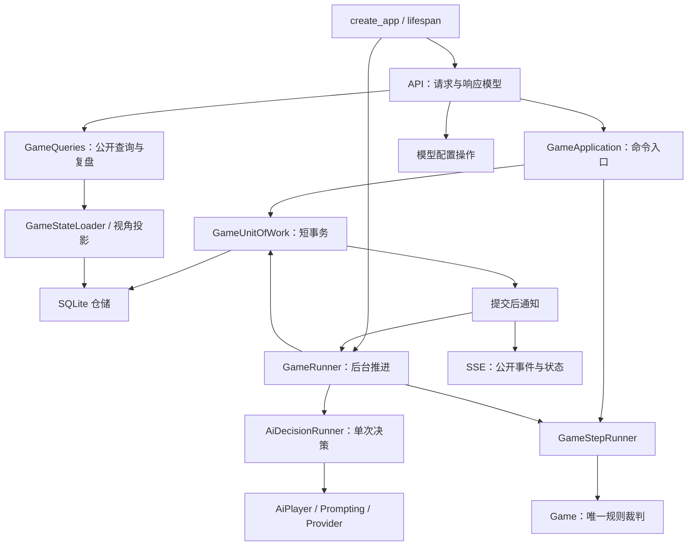

# 后端重设计方案

设计日期：2026-10-17。本文是目标方案，不是当前代码说明；当前实现和已知问题见[后端模块与运行机制](./backend-modules.md)，术语见[领域术语](../CONTEXT.md)。

原 GameService 重设计的模块提取、单步事务两个阶段已经实现，记录见[第二阶段实施计划](./game-service-phase2-plan.md)。本方案在此基础上重新划分整个后端的应用职责，不将历史计划中的目标接口视为当前能力。

## 1. 判断与取舍

保留 Python、FastAPI、SQLite、文件型模型配置和纯规则核心，重设计应用层。它们适合当前本地单用户、多房间和模型实验需求；已经确认的问题主要来自职责混合、响应边界和后台任务生命周期，不是技术栈不足。

本次设计解决五件事：

1. 普通游玩响应不包含其他玩家身份、任务行动或私有决策信息。
2. 建局和每次推进都具备完整事务边界。
3. 进程中断后能恢复尚未执行完的推进意图，而不只是重建规则状态。
4. AI 网络调用不持有全局锁或 SQLite 写事务，旧回答不能写入新状态。
5. 真人 AI 代打和普通 AI 玩家共用一次决策与提交流程。

暂不引入微服务、外部任务队列、ORM、通用工作流框架或多进程部署。也不把未消费的记忆快照扩展成新的智能体系统。

## 2. 目标职责



| 组件 | 负责什么 | 不负责什么 |
| --- | --- | --- |
| `GameApplication` | 创建、真人动作、请求 AI 代打、恢复、归档和删除；验证命令版本，提交后唤醒推进器。 | 不逐阶段调用模型，不拼接房间复盘。 |
| `GameQueries` | 列表、真人视角状态、公开事件、已完成对局复盘、导出和用量汇总；使用显式响应白名单。 | 不执行动作、不请求模型、不启动后台任务。 |
| `GameRunner` | 查找待推进对局，选择行动者或系统结算，执行一次规则步，再判断是否继续。 | 不保存规则细节，不自己拼 Prompt。 |
| `AiDecisionRunner` | 从玩家覆盖或对局默认值解析模型，调用 `AiPlayer`，统一成功和失败审计数据。 | 不提交数据库，不安排下一回合。 |
| `GameStepRunner` | 将玩家动作或系统结算转成新状态和规则事件。 | 不区分真人输入还是模型输入，不访问外部服务。 |
| `GameUnitOfWork` | 为一次操作创建独立连接和事务，检查版本，统一提交或回滚。沿用 `GameCommitter` 的单步提交逻辑。 | 不在网络调用期间保持事务，不把内存更新当成数据库事务的一部分。 |
| `GameStateLoader` | 从建局事实、玩家和规则历史加载带版本的状态，保留坏事件诊断。 | 不把错误暂停、归档等运行状态从规则事件中猜出来。 |
| 视角投影函数 | 生成公开列表、玩家视角、公开事件和完成态审计视图。可先作为 `GameQueries` 的内部函数。 | 不直接序列化完整仓储对象，不使用前端隐藏控件代替信息过滤。 |

保留现有 `game`、`ai`、`prompting`、`llm`、`storage` 包，不进行纯粹的目录搬家。应用职责主要在 `services` 内调整；`GameService` 可以在迁移期间作为兼容门面转发到新组件。只为上述已有责任增加边界，不为每个函数再建立抽象接口。

## 3. 状态来源与数据约定

### 3.1 区分规则事实、摘要和运行状态

| 数据 | 目标约定 |
| --- | --- |
| 建局元数据、玩家真相、任务配置 | 是恢复初始对局所需的事实，必须持久化。优先使用 `game_created` 已记录的任务配置，不让进行中对局随着当前常量变化。缺少该字段的旧局使用经过测试的兼容读取。 |
| 规则事件 | 是后续规则状态变化的事实；按内部序号重放，私有任务行动仍须保留。 |
| `current_round`、`current_phase`、`winner` | 是规则状态的派生摘要，可通过恢复结果校验和重建。 |
| `status`、`archived_at`、模型配置 ID | 是运行管理或配置状态，不能从规则历史完整重建，也不能当作可丢弃缓存。 |
| AI 审计与记忆快照 | 不改变规则状态，不向其他玩家公开，不参与规则重放。 |
| 内存缓存 | 只加速读取，以持久化版本验证；不得作为命令提交的唯一依据。 |

不要求将现有规则改写成另一套事件应用引擎；继续使用确定性规则函数和显式重放映射。已知审计类型可以跳过，未知事件类型必须给出不支持的诊断，不能默认为无影响。

### 3.2 最小新增运行字段

在 `games` 增加两个目标字段：

| 字段 | 语义 |
| --- | --- |
| `revision` | 对局持久化修改版本。接受规则动作、安排 AI 代打、暂停、恢复、归档等影响执行的修改都递增，作为过期请求与过期模型回答的校验依据。 |
| `advance_mode` | `null` 表示无需后台推进；`auto` 表示继续普通 AI 或系统结算；`human_once` 表示已请求 AI 代打真人的一次动作。 |

`error_paused` 时保留失败前的 `advance_mode` 以便重试，但不执行。归档或结束时清空它。普通 AI 成功或 `human_once` 成功后，根据新状态设为 `auto` 或 `null`，不会自动接管下一个真人动作。

后台任务可执行条件为：未归档、`status=active`、`advance_mode` 非空。重复收到唤醒信号不能重复应用同一动作。

## 4. 目标命令与查询接口

以下接口为设计契约，不是现有公开方法：

```text
GameApplication.create_game(request) -> GameView
GameApplication.submit_human_action(game_id, expected_revision, action) -> GameView
GameApplication.request_human_ai(game_id, expected_revision) -> GameView
GameApplication.resume_game(game_id) -> GameView
GameRunner.advance_one(game_id) -> StepOutcome
GameQueries.get_game(game_id) -> GameView
GameQueries.get_public_events(game_id, after) -> PublicEventPage
GameQueries.get_completed_review(game_id) -> RoomReview
```

动作来源不能决定规则豁免。真人 ID 从对局读取，普通真人动作和 AI 代打均经过同一个 `GameStepRunner`。

对 `/actions` 和 `/ai-actions/human` 增加必需的 `expected_revision`；版本过期返回 409 和当前版本，不重试执行旧动作。其他不合法动作返回 400。查询、建局和管理操作不要求客户端提供该字段，管理操作在短事务中验证当前状态。

现有 URL 和公开状态主体保留，增加 `revision`、`is_advancing`。目标动作接口提交当前操作后即返回，不等待后续模型链路；这是异步语义和请求契约的变化，必须与前端及 HTTP 测试同步迁移，不能当作无行为变化的内部重构。

## 5. 执行与事务

### 5.1 创建与真人动作

```text
短事务开始
  -> 创建完整初始记录，或读取最新状态并检查 expected_revision
  -> 校验当前行动者与规则，构造规则事件
  -> 保存规则事件、摘要和运行状态
  -> 设置 advance_mode，递增 revision
提交
  -> 更新或失效缓存
  -> 唤醒 GameRunner 和 SSE
  -> 返回公开状态
```

创建时必须将 `games`、`players` 和全部开局事件一起提交。归档、删除也通过工作单元提交；归档取消推进意图。接受有效的真人手动动作可以覆盖同阶段尚未完成的 AI 代打，递增版本后旧模型回答自然失效。

### 5.2 一次 AI 动作

```text
短读取：获得当前状态、revision、行动者和 advance_mode
关闭读取范围
无数据库事务：执行模型调用
短写事务：
  -> 重读并校验 revision、阶段、行动者、运行状态与推进模式
  -> 不匹配则丢弃旧回答，不改变当前规则状态或暂停新状态
  -> 匹配则应用规则，构造 StepResult 和审计记录
  -> 一起保存事件、AI 审计、必要的记忆留档、摘要和运行字段
  -> 递增 revision，提交
提交后通知，再决定下一步
```

系统结算和善方固定成功任务不调用模型，但使用同一规则执行与提交路径。模型调用期间不能占用 SQLite 写事务；缩小锁粒度之前，先完成独立连接和版本检查。

失败时也必须先检查版本。只有仍对应当前动作的失败，才能原子记录审计并设置 `error_paused`；旧调用的失败不能暂停已经前进或归档的对局。

外部模型请求在进程崩溃后可能被重新调用，本方案保证规则动作不会重复提交，不承诺模型调用或计费恰好一次。

### 5.3 恢复、重试与中断

- 应用启动时扫描持久化推进意图；运行中通过通知唤醒，并以定期扫描补偿“已提交但尚未唤醒”的窗口。扫描只安排任务，不代替规则判断。
- `resume_game()` 对 `error_paused` 清除暂停并保留原推进模式；对 `active` 且处于 AI 或系统结算回合的旧局补设 `auto`。轮到真人且没有代打意图时直接返回，不擅自接管。
- `human_once` 可在重启或重试后继续执行一次。普通 AI 推进不能借此持续接管真人。
- 恢复规则状态和恢复推进意图是两个步骤；GET 状态、房间和事件始终是查询，不通过读取偷偷续局。
- 有界执行器负责安排任务，同局同时最多一个推进任务；先支持单进程，不添加跨进程租约。阶段步数达到上限时转为可诊断的暂停，不留在无任务执行的 `active`。

## 6. 公开视角与审计边界

### 6.1 显式投影

- 列表响应只选择房间展示和进度字段，不能返回原始 `role_set`。
- 玩家状态只从合法 `PrivateView` 生成，只有对局完成后才公开完整身份。
- 普通事件接口只输出允许的游戏事实。`ai_decision`、私有理由、Prompt、模型原始回答和模型调用类型不进入游玩事件流。
- 不只删除 `private_payload`：任务阶段是否存在模型决策记录也可能暴露身份，公开事件的序号不能泄露内部审计记录数量。
- 公开事件序号只对允许输出的事件连续编号，与内部审计序号分离。初期可在查询投影中生成，不要求新增公共事件表；历史数据保持不动。
- `/room`、私有事件查询和私有导出只在完成态返回完整审计，未完成时请求完整审计返回 409。显式请求私有数据或归档都不是绕过完成态检查的依据。

普通对局查询与已完成复盘需要不同的响应模型。旧日志不必改写，公开查询统一过滤旧数据中的私有理由；存量私有事件继续服务恢复和审计。客户端切换到完整复盘时使用独立事件集合，不将内部审计序号与公开序号混合合并。

公开查询和 SSE 共用同一序号映射。初期先加载历史、生成公开投影及公开序号，再按 `after` 筛选；不能将公开游标直接传给按内部序号读取的 `EventStore.list_events_after()`。

### 6.2 投票与 SSE

`vote_cast` 的公开投影始终只表示已投票，不输出票值；`vote_result` 的公开投影包含该次结算的完整票型。这样结算信息能随新事件到达，不依赖修改客户端已收到的旧投票事件。旧日志通过此前对应的 `vote_cast` 聚合补足结果投影，不改写历史记录。

保留 `game-event` 消息；新增 `game-state` 消息携带最新公开状态和 `revision`，用来表达错误暂停、恢复和 AI 代打安排等不一定产生公开规则事件的变化。SSE 建连先返回当前状态，再按公开事件游标补发历史，随后等待提交通知。公开事件 ID 使用公开序号；`game-state` 不改变事件游标。

前端按 `revision` 忽略旧状态，以 `is_advancing` 控制等待状态。连续代打要等待本次后台动作结束或暂停后再请求下一步；不能把“请求已接受”当成“AI 已完成动作”。

## 7. 生命周期与模型配置

`create_app()` 负责装配，FastAPI lifespan 负责启动、扫描和停止推进器。每次查询或工作单元使用自己的 SQLite 连接，在各自范围内关闭；SQLite `:memory:` 测试使用单测试作用域连接或共享内存 URI，不能让每次连接得到不同数据库。

不通过全局 SQLite 连接跨线程共享事务，也不让模型配置操作提交其他对局尚未结束的事务。停止时停止接收新推进任务，已提交的推进意图保留给下次启动。

`LlmProfileRepository` 最终只负责 JSON 读写。模型选择所需的玩家覆盖和对局默认配置已包含在加载结果中，由 `AiDecisionRunner` 选择 ID，不再让文件仓储查询 SQLite。文件修改在进程内串行处理，并保留临时文件替换保存。

模型配置接口继续保持简单的 CRUD，不为追求统一而增加空转发服务。连通性测试与游戏调用使用同一个 `LlmCompletionResult` 契约，读取 `.content`，测试替身也遵守该契约。

将两层重试分别命名为 `transport_retries` 和 `parse_retries`：前者处理明确捕获的超时与空回答，后者处理输出解析失败，不将所有网络错误都改成自动重试。新字段缺失时分别从旧 `timeout_retries` 兼容读取，表单、API 和文件格式同步迁移。

## 8. 分阶段迁移

以下阶段均未因本次文档更新而完成。先修真实问题，再改变运行方式；每阶段都应能独立验证。

### 阶段一：修复边界和返回契约

涉及 `backend/app/api/`、`backend/app/services/event_visibility.py`、`backend/app/services/game_service.py`、前端房间复盘调用和相关 API 测试。

1. 为列表、玩家状态、公开事件、完成态审计定义响应白名单；移除公开身份顺序和 AI 私有决策信息，使用独立公开事件序号。
2. 对完整房间审计、私有事件查询和私有导出增加完成态检查，普通状态仍可读取。前端对未完成的归档房间展示公开状态与事件，不请求完整审计。
3. 统一 Provider 返回对象的调用方式，连通性测试读取 `.content`；使用真实 Provider 加假 transport 验证适配链路。
4. 增加 HTTP 集成场景，验证查询、SSE 和导出，而不是只检查前端是否展示了字段。

验收：进行中对局没有上述直接信息泄漏；完成态仍能复盘；模型测试成功响应不会转为 500。

### 阶段二：统一工作单元与中断恢复

涉及 `backend/app/storage/database.py`、`backend/app/storage/schema.py`、`backend/app/storage/game_repository.py`、`backend/app/services/game_flow.py` 和应用入口。

1. 引入工作单元，把建局和推进步纳入完整事务；管理入口不再依赖共享连接的自动提交副作用。
2. 迁移增加 `revision`、`advance_mode`，旧局的版本从 0 起步，不使用内部审计数量作为公开版本。先从规则历史校验阶段；可成功恢复的未归档 `active` AI／系统回合补设 `auto`，真人回合、暂停、完成和归档局不自动执行。历史中未保存的真人代打意图不猜测；旧暂停局在显式恢复时仅按当前规则判断是否需要 `auto`。
3. 读取初始任务配置时优先使用已保存的建局内容，给旧局提供明确兼容路径；保留原有重放错误诊断。
4. 实现显式续局和启动扫描。损坏历史保持停止并给出诊断，不截断后继续追加。

验收：建局任一步失败均不留下半局；重启后不会停在没有任务的正常 AI 回合；多次恢复不会重复应用规则事件，读取接口不触发推进。

### 阶段三：收敛应用职责并迁移异步接口

涉及 `backend/app/services/`、`backend/app/api/games.py`、`backend/app/api/models.py`、`frontend/src/api.ts`、`frontend/src/App.tsx`。

1. 将查询和视角投影移入 `GameQueries`；命令放入 `GameApplication`，旧 `GameService` 暂作适配。
2. 普通 AI 与真人 AI 代打统一进入 `AiDecisionRunner` 和 `GameRunner`，删除重复阶段分支，保留 `GameStepRunner` 的规则调用。
3. 对两个动作接口要求 `expected_revision`，补齐请求与响应模型、409 处理、`revision` 和 `is_advancing`。
4. 引入每局唯一的有界后台推进任务，模型调用移出事务和全局锁；提交时重读并验证版本与运行条件。
5. 增加 `game-state` SSE，前端按版本更新状态，调整等待、连续代打和错误恢复，不再假设动作请求返回时所有 AI 已执行完。

验收：慢模型不阻塞其他房间的命令；两次重复版本的命令只接受一次；归档、手动动作或恢复后返回的旧 AI 成功／失败都不改变新状态；代打意图重启后仍只执行一次真人动作。

### 阶段四：收尾与按需优化

1. 使用应用工厂和 lifespan 完成任务与连接生命周期，去除生产路径的全局可变装配。
2. 将文件配置仓储与 SQLite 模型选择分开，明确网络重试和解析重试参数，保留旧配置兼容。
3. 删除迁移期间不再使用的兼容转发；只有实际读取成本成为问题时才增加带版本的缓存或状态快照。
4. 校验摘要只重建规则派生字段，不覆盖暂停、归档、配置和推进意图。

不以机械拆小文件为验收标准；职责单一、状态可恢复、接口可验证才是完成条件。

## 9. 验证范围

按阶段运行相关单元测试及 HTTP／生命周期集成测试。后端常用命令：

```powershell
.venv\Scripts\python.exe -m unittest discover -s tests -v
```

涉及异步接口与前端协同时，再运行：

```powershell
cd frontend
npm run test
npm run build
```

关键集成场景包括：创建事务失败回滚；所有 AI 决策阶段的错误暂停；持久化数据库重开后的续局；代打一次意图恢复；慢调用期间读取和其他房间命令；旧回答和旧错误丢弃；公开字段与审计记录隔离；仅依赖公开 SSE 事件完成投票复盘。

模型和 HTTP 测试使用假 transport，不依赖真实密钥或真实模型。接口和生命周期行为需要可执行测试，源码字符串检查不能代替这些验收。
